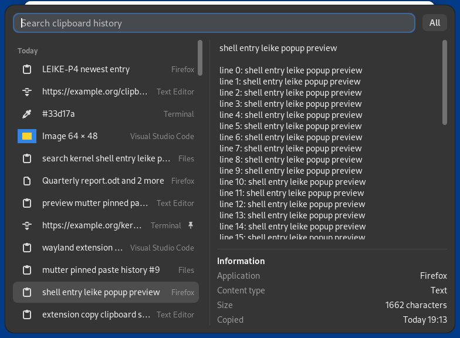

# Leike

Leike keeps a history of your clipboard on GNOME. It has the look and the flow of the clipboard history in [Raycast](https://www.raycast.com/) and [Alfred](https://www.alfredapp.com/). Leike is Finnish for a clip.

Design goal is to be fast and to stay out of the way. Super+C, Super+V and Super+X copy, paste and cut in each application, also in a terminal. The history keeps text and images, and it stays after you log out. One shortcut opens the history: type to filter, move with the arrow keys and press Enter.

Leike is in development and has no release yet.

## Screenshots



The history popup shows the search entry and the type filter on top, the entries by day on the left, and the preview with the Information table on the right.

## Default shortcuts

| Action        | Shortcut                                        | Sent to app / terminal        |
|---------------|-------------------------------------------------|-------------------------------|
| Copy          | Super+C                                         | Ctrl+C / Ctrl+Shift+C         |
| Paste         | Super+V                                         | Ctrl+V / Ctrl+Shift+V         |
| Cut           | Super+X                                         | Ctrl+X / Ctrl+Shift+X         |
| Open history  | Super+AltGr+C (`<Super><Mod5>c`), Super+Alt+C   | opens the popup               |

In the popup: Up and Down move, Page Up and Page Down move by 10, Enter copies, Shift+Enter copies and pastes, Delete removes the entry when the cursor is at the end of the search text, Ctrl+P pins or unpins the entry, Tab and Shift+Tab cycle the type filter, Escape closes. Typing filters. A pointer move selects the row, a click on a row copies it as Enter does, a click outside the popup closes it, a drag on the popup background moves the popup, and the gear button in the top right corner opens the preferences window.

Leike sends Ctrl+Shift+C, V and X to a terminal and Ctrl+C, V and X to other windows. The WM_CLASS of the focused window selects the keys. The default terminal list is in the setting `terminal-wm-classes`: org.gnome.Terminal, gnome-terminal-server, org.gnome.Ptyxis, org.gnome.Console, Alacritty, kitty, foot, org.wezfurlong.wezterm, com.mitchellh.ghostty, Terminator and Tilix.

GNOME 46 binds Super+V to the notification list. The preferences window shows the conflict and can remove the GNOME binding.

## Install manually the release zip

Node.js is not needed at runtime as GNOME Shell runs the extension.

1. Download `leike@repo.pet.zip` from the [latest GitHub release](https://github.com/pre/leike/releases/latest), or build it from source:

   ```sh
   npm install
   npm run pack   # writes leike@repo.pet.zip
   ```

2. Install Leike as a GNOME extension. Use `--force` to replace an installed version:

   ```sh
   gnome-extensions install --force leike@repo.pet.zip
   ```

3. Log out and log in again. On Wayland, GNOME Shell loads new extension code only at login.
4. Enable the extension:

   ```sh
   gnome-extensions enable leike@repo.pet
   ```

5. At the first enable, Leike opens its preferences window. On the Shortcuts page, click the red sign on the Paste row and then **Remove from GNOME**. GNOME then shows the notification list with Super+M only, and Super+V pastes. You can also do this in a terminal:

   ```sh
   gsettings set org.gnome.shell.keybindings toggle-message-tray "['<Super>m']"
   ```

To open the preferences window again, use the gear button in the history popup, the Extensions application or `gnome-extensions prefs leike@repo.pet`.

## Settings

The preferences window has three pages:

- **Shortcuts**: the shortcuts for copy, paste, cut and open history. Each row shows a conflict with a GNOME shortcut. Open history has two shortcuts by default. The capture dialog stores Super+AltGr+C as `<Super><Mod5>c`.
- **History**: the limits and the Clear history button.
  - Maximum number of entries, 500 by default. When the history is full, Leike removes the oldest entry that is not pinned.
  - Maximum image size in MiB, 10 by default. Leike does not keep a larger image.
  - Maximum text size in KiB, 1024 by default. Leike does not keep a larger text. A large text makes each save and each load of the history slow.
  - Clear history removes all entries and images, also the pinned entries.
- **Applications**: the terminal list (`terminal-wm-classes`) and the blocked applications (`blocklist-wm-classes`). To see the WM_CLASS of a window, press Alt+F2, type `lg`, press Enter and open the Windows tab.

The bottom of each page shows the version: `Leike v1.2.3` for a release, or `Leike git-<commit>` for a local build. The release workflow writes the release version to `version-name` in `metadata.json`. In a local build, `gnome/esbuild.mjs` writes `git-<commit>` there.

## How it works

Wayland has no command that tells an application to copy or paste. So Leike sends Ctrl+C, or Ctrl+Shift+C to a terminal. When you press Super+C, Super is still down, and an application does not copy on Super+Ctrl+C. GNOME Shell keeps one modifier state for its own shortcuts and one for the application. Leike sends its keys as input method keys, and these change only the state of the application: a Super release, then Ctrl+C, then a Super press. The application copies at the key press, and Super stays down for the next shortcut. Super held with V pressed three times pastes three times, and Super held with C and then V copies and pastes. See `docs/adr/0014-copy-paste-cut-send-forwarded-keys-at-the-key-press.md`.

Known limits:

- This works in a Wayland session.
- A copy, paste or cut shortcut can use Shift, Ctrl, Alt and Super. A shortcut with AltGr does not work.
- Leike sends the key codes of a PC keyboard for Ctrl and Shift. An XKB option that moves the left Ctrl or the left Shift key, for example Swap Ctrl and Caps Lock, breaks the keys.
- The letter is correct on each layout when the shortcut uses the letter of its action, as Super+V does for paste. Paste from the popup with Shift+Enter, and a shortcut with a different key, send the key at the QWERTY position of the letter.

Leike watches the clipboard in GNOME Shell. It keeps text, images (PNG), links, colors and file lists. When you copy content that is already in the history, the entry moves to the top. Leike does not add the changes that it makes itself.

## Privacy

- Leike does not keep a clipboard change that offers the mime type `x-kde-passwordManagerHint`. KeePassXC, the Bitwarden desktop application and `wl-copy --sensitive` set this type when they copy a password. Leike checks the type before it reads the content.
- Leike does not keep a change from an application whose WM_CLASS is in the blocked applications list. Add a password manager that does not set `x-kde-passwordManagerHint` to this list.
- The history is not encrypted. The files have mode 0600 and the directories 0700, so only your user can read them.
- The history stays on your computer. Leike does not use the network.

## Data location

The history is in `~/.local/share/leike/` (`$XDG_DATA_HOME/leike/` when `XDG_DATA_HOME` is set):

- `history.json`: the entries. Leike writes it atomically, with a temporary file and a rename.
- `images/<id>.png`: one file for each image entry.

When `history.json` is not valid, Leike moves it to `history.json.broken-<time>` and starts with an empty history. To remove all history, use Clear history in the preferences window, or delete the directory. Clear history also deletes the `history.json.broken-<time>` files.

## Build from source

You need Node.js 22 or later, npm, `glib-compile-schemas`, `gjs` and `zip`.

```sh
npm install
npm run build   # core with tsc, extension with esbuild, to gnome/dist/
npm test        # unit tests and the GJS tests
npm run pack    # writes leike@repo.pet.zip
npm run reload  # packs, installs the zip, disables and enables the extension
```

`npm run reload` makes the shell read the schema again, so a new default works at once. The shell keeps the extension and prefs code until the next login.

### Test in a headless shell

On Wayland, GNOME Shell loads new extension code only at login. Do not test Leike in a nested shell (`gnome-shell --nested`). On GNOME 46 a virtual keyboard in a nested shell sends its keys through the Xwayland of your session, so the keys of a test can go to your real windows. Use a headless shell with its own data, config and runtime directories. See `docs/adr/0012-sandbox-tests-in-a-headless-shell.md`.

```sh
sandbox=$HOME/tmp/leike-sandbox
export XDG_DATA_HOME=$sandbox/data XDG_CONFIG_HOME=$sandbox/config
export XDG_CACHE_HOME=$sandbox/cache XDG_STATE_HOME=$sandbox/state
export XDG_RUNTIME_DIR=$sandbox/run XDG_SESSION_ID=leike-sandbox-none
export GSETTINGS_BACKEND=keyfile GNOME_SHELL_SESSION_MODE=user
unset DISPLAY WAYLAND_DISPLAY DBUS_SESSION_BUS_ADDRESS SESSION_MANAGER
mkdir -p "$XDG_RUNTIME_DIR" "$XDG_CONFIG_HOME/glib-2.0/settings" && chmod 700 "$XDG_RUNTIME_DIR"
cat > "$XDG_CONFIG_HOME/glib-2.0/settings/keyfile" <<'EOF'
[org/gnome/shell]
enabled-extensions=['leike@repo.pet']
disable-user-extensions=false

[org/gnome/desktop/screensaver]
lock-enabled=false
EOF
gnome/install.sh
dbus-run-session -- gnome-shell --headless --wayland --no-x11 --sm-disable \
  --mode=user --virtual-monitor 1280x800 --wayland-display=leike-sandbox-0
```

`XDG_SESSION_ID` keeps the headless shell away from the logind session of your real session. The headless shell has no window. Start applications in the same environment with `WAYLAND_DISPLAY=leike-sandbox-0`, and read the log in the terminal. Stop the shell with Ctrl+C.

### Preview the preferences window

```sh
npm run prefs                 # uses your real settings
npm run prefs-sandbox         # uses temporary settings, nothing real changes
```

`gnome/prefs-dev.sh` builds `gnome/dist` and opens `gnome/dist/prefs.js` with `gnome/test/prefs-launcher.js`. The window uses the schema in `gnome/dist/schemas`, not the installed schema.

## Publish a release

```sh
bin/release-github v1.2.3    # or major, minor or patch
```

The script makes a draft GitHub release at HEAD, with notes from the conventional commits since the previous `v*` tag. Then it starts `.github/workflows/release.yml`. The workflow runs the tests, writes the version to `version-name` in `metadata.json`, packs `leike@repo.pet.zip` and attaches the zip to the draft. When the build is done, the script opens the draft. Examine the draft and press **Publish release**. Publishing creates the git tag. Then upload the same zip at https://extensions.gnome.org/upload/.

The workflow needs the repository secret `RELEASE_BOT_TOKEN`, a token that can upload release assets. The default `GITHUB_TOKEN` of the workflow is read-only. Use `bin/release-github v1.2.3 --dry-run` to see the notes without a change on GitHub.

## Repository layout

- `core/`: the clipboard history data transforms, with no GNOME imports. A KDE, Windows or macOS front end can use the same core.
- `gnome/`: the GNOME Shell extension, the schema in `gnome/schemas/` and the build scripts.
- `bin/release-github` and `.github/workflows/release.yml`: the release, see Publish a release.
- `docs/adr/`: the architecture decisions. Read them before you change the architecture.

## License

MIT, see `LICENSE`.
